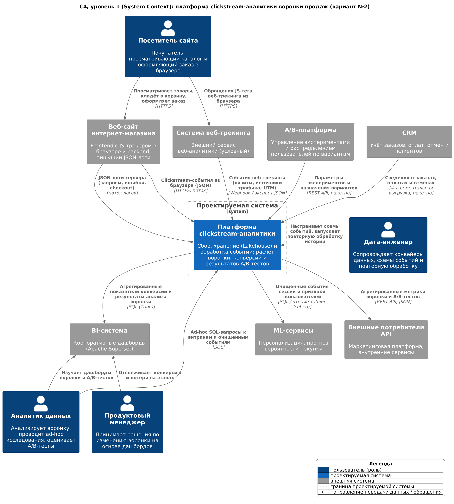
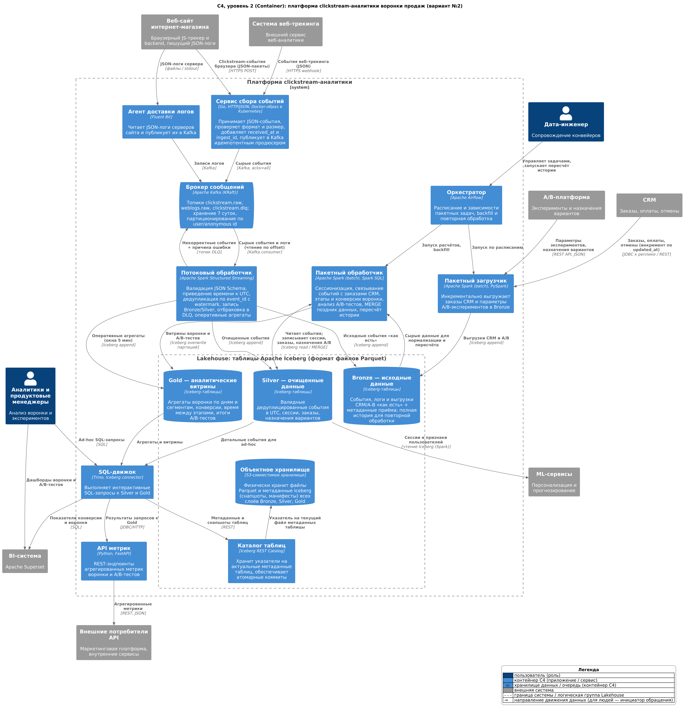

::: {custom-style="Title Page"}
[ПОЛНОЕ НАИМЕНОВАНИЕ УЧЕБНОГО ЗАВЕДЕНИЯ]

[Наименование факультета / института]

[Наименование кафедры]
:::

::: {custom-style="Title Page Main"}
ОТЧЁТ

по лабораторной работе № 1

«Выбор и обоснование архитектуры системы хранения и обработки данных для бизнес-задачи»

по дисциплине «[Название дисциплины]»

Индивидуальный вариант № 2
:::

::: {custom-style="Title Page Right"}
Выполнил(а): студент(ка) группы [Номер группы]

[Фамилия Имя Отчество]

Проверил(а): [должность, учёная степень]

[Фамилия И. О. преподавателя]
:::

::: {custom-style="Title Page Bottom"}
[Город] [Год]
:::

# 1. Цель работы

Цель работы — на примере конкретной бизнес-задачи сравнить архитектурные подходы к хранению и обработке данных (Data Warehouse, Data Lake, Data Lakehouse, Data Mesh), обоснованно выбрать целевую архитектуру, спроектировать систему приёма, хранения, обработки и потребления данных и представить её в нотации C4 на уровнях System Context и Container.

Для достижения цели решаются следующие задачи:

1. Проанализировать четыре архитектурных подхода и оценить их применимость к индивидуальному варианту.
2. Выбрать и аргументировать целевую архитектуру с учётом компромиссов.
3. Спроектировать источники, механизмы приёма (ingestion), слои хранения, обработку и потребление данных, предложить согласованный технологический стек.
4. Построить диаграммы C4 уровней 1 и 2.
5. Описать движение потоков данных (Data Flow) и ключевые метрики воронки продаж.

Работа носит проектный характер: система спроектирована, но не реализовывалась и не тестировалась. Все численные оценки в отчёте являются расчётными или условными и отмечены соответствующим образом.

# 2. Постановка бизнес-задачи (индивидуальный вариант № 2)

**Бизнес-задача:** создать систему обработки clickstream-данных для оптимизации воронки продаж с использованием потоковых событий сайта объёмом 100–300 млн событий в месяц.

**Источники данных:**

- JSON-логи сайта (серверные логи запросов, ошибок, шагов оформления заказа);
- события из систем веб-трекинга (визиты, источники трафика, UTM-метки);
- результаты и параметры A/B-тестов (эксперименты, варианты, назначения пользователей);
- CRM-данные о заказах (заказы, оплаты, отмены, возвраты).

**Цель системы:** собирать, хранить и обрабатывать события пользовательского поведения, анализировать этапы воронки продаж, выявлять места потери пользователей, оценивать результаты A/B-тестов и предоставлять аналитические данные бизнес-пользователям (аналитикам, продуктовым менеджерам), BI-системе, внешним потребителям через API и ML-сервисам.

**Профиль нагрузки (расчётная оценка).** Объём 100–300 млн событий в месяц соответствует в среднем примерно 39–116 событиям в секунду (300 млн / (30 × 86 400 с) ≈ 116 событий/с). Clickstream имеет выраженную суточную и сезонную неравномерность, поэтому в пиках (распродажи, рассылки) следует закладывать запас порядка ×5–10, т. е. ~600–1 200 событий/с. При условном среднем размере JSON-события 1–2 КБ ежемесячный объём сырых данных составит порядка 100–600 ГБ, а с учётом хранения истории за несколько лет — единицы терабайт. Это не экстремальный, но устойчиво растущий поток, требующий горизонтально масштабируемого приёма и дешёвого долговременного хранения.

**Ключевые требования, вытекающие из варианта:**

Таблица 1 — Требования варианта № 2 и их архитектурные следствия

| № | Требование | Следствие для архитектуры |
|-----|-----------------------------------|------------------------------------------------------------|
| Т1 | Поток событий с высокой скоростью поступления | Нужен буфер (брокер сообщений) и потоковая обработка |
| Т2 | Полуструктурированный формат JSON с меняющейся схемой | Хранение сырых данных без жёсткой схемы, эволюция схемы |
| Т3 | Хранение сырых событий и истории | Дешёвое масштабируемое хранилище, повторная обработка |
| Т4 | Объединение с CRM и A/B-платформой | Пакетная загрузка, надёжные ключи связывания |
| Т5 | Быстрое получение показателей воронки | Аналитические витрины, SQL-доступ, BI и API |
| Т6 | Возможность ML (персонализация, прогноз) | Доступ к детальным данным в открытом формате |
| Т7 | Корректность метрик | Дедупликация, единые временные метки, транзакционность записи |

# 3. Краткие теоретические сведения об архитектурах

## 3.1 Data Warehouse (хранилище данных)

**Ключевая идея.** Централизованное предметно-ориентированное хранилище интегрированных, очищенных и исторических данных для аналитики (OLAP), отделённое от транзакционных систем (OLTP). Данные загружаются по заранее определённой схеме (Schema-on-Write), обычно процессом ETL.

**Где хранятся данные.** В аналитической СУБД (часто колоночной, MPP) в виде структурированных таблиц — звёздная или снежинковая схема, витрины данных (data marts).

**Кто управляет данными.** Централизованная команда хранилища (DWH/BI-команда), которая проектирует модель, ETL-процессы и отвечает за качество.

**Сильные стороны:** высокая производительность SQL-запросов; согласованные, проверенные данные («единая версия правды»); зрелые инструменты BI; транзакционность и контроль доступа.

**Ограничения:** жёсткая схема и дорогое изменение структуры; плохо подходит для полуструктурированных и неструктурированных данных; сырые данные обычно не сохраняются; хранение больших объёмов истории дорого (вычисления и хранение часто связаны); ограниченная поддержка ML-сценариев, которым нужны детальные данные.

## 3.2 Data Lake (озеро данных)

**Ключевая идея.** Хранение данных любых типов в исходном виде в дешёвом масштабируемом хранилище; структура применяется при чтении (Schema-on-Read). Процесс загрузки — ELT: сначала загрузка, затем преобразование.

**Где хранятся данные.** В распределённой файловой системе (HDFS) или объектном хранилище (S3-совместимом) в виде файлов: JSON, CSV, Avro, Parquet, ORC, изображения и т. д.

**Кто управляет данными.** Центральная платформенная команда данных; потребители (аналитики, data scientists) сами интерпретируют структуру.

**Сильные стороны:** низкая стоимость хранения; поддержка любых форматов; хранение сырых данных и полной истории; разделение хранения и вычислений; удобство для ML и исследовательского анализа.

**Ограничения:** нет транзакций (ACID) на уровне файлов; сложны обновления и удаления записей; без каталога, метаданных и контроля качества озеро превращается в «болото данных» (Data Swamp); производительность SQL ниже, чем у DWH; для BI обычно приходится дополнительно копировать данные в DWH (двухуровневая архитектура Data Lake + DWH).

## 3.3 Data Lakehouse

**Ключевая идея.** Объединить дешёвое открытое хранилище озера данных с возможностями хранилища: ACID-транзакциями, схемами и их эволюцией, версионированием (time travel), эффективными SQL-запросами. Достигается за счёт слоя метаданных — открытого табличного формата (Apache Iceberg, Delta Lake, Apache Hudi) поверх файлов Parquet/ORC.

**Где хранятся данные.** В объектном хранилище в открытых форматах; метаданные таблиц (схема, снапшоты, списки файлов) хранятся рядом с данными, а указатель на актуальную версию — в каталоге таблиц. Данные часто организуются в слои Bronze (сырые), Silver (очищенные), Gold (витрины) — так называемая medallion-архитектура.

**Кто управляет данными.** Как правило, центральная платформенная команда данных (организационная модель не меняется по сравнению с Data Lake / DWH).

**Сильные стороны:** одна копия данных для BI, SQL-аналитики, потоковой обработки и ML; ACID-транзакции и согласованное чтение; эволюция схемы; повторная обработка истории и time travel; несколько вычислительных движков (Spark, Trino, Flink) работают с одними таблицами; отсутствие привязки к поставщику.

**Ограничения:** более сложная эксплуатация (каталог, компактизация мелких файлов, очистка снапшотов); задержка интерактивных запросов, как правило, выше, чем у специализированной колоночной СУБД; требуется квалифицированная команда; технологии развиваются быстро, нужна проверка совместимости версий.

## 3.4 Data Mesh

**Ключевая идея.** Не технология, а социотехнический (организационный) подход: ответственность за аналитические данные децентрализуется и передаётся доменным командам. Основные принципы (по Ж. Дехгани): доменное владение данными, данные как продукт, самообслуживаемая платформа данных, федеративное вычислительное управление (federated computational governance).

**Где хранятся данные.** Распределённо — в доменных data products. Каждый продукт данных может технически реализовываться как DWH, Data Lake или Lakehouse на общей платформе самообслуживания.

**Кто управляет данными.** Доменные команды (например, «Маркетинг», «Заказы», «Каталог»), которые владеют своими продуктами данных; общие стандарты задаются федеративным органом управления.

**Сильные стороны:** масштабирование в крупных организациях со множеством доменов; устранение «бутылочного горлышка» центральной команды; данные ближе к экспертам предметной области; явная ответственность за качество.

**Ограничения:** высокая организационная зрелость и стоимость внедрения; нужна развитая платформа самообслуживания; риск дублирования и несогласованности при слабом управлении; для одной предметной области и одной команды избыточен.

# 4. Сравнительная таблица архитектур

В таблице 2 приведено сравнение подходов по общим характеристикам, в таблице 3 — оценка применимости к варианту № 2.

Таблица 2 — Общее сравнение архитектурных подходов

| Характеристика | Data Warehouse | Data Lake | Data Lakehouse | Data Mesh |
|--------------------|--------------------|--------------------|--------------------|--------------------|
| Природа подхода | Технологическая архитектура | Технологическая архитектура | Технологическая архитектура | Организационная модель |
| Схема | Schema-on-Write | Schema-on-Read | Schema-on-Write для таблиц + эволюция схемы; сырые данные — Schema-on-Read | Определяется доменом |
| Типы данных | Структурированные | Любые | Любые (сырые) + табличные | Любые |
| Транзакции (ACID) | Да | Нет | Да (табличный формат) | Зависит от реализации |
| Хранение сырых данных | Как правило, нет | Да | Да (слой Bronze) | Зависит от реализации |
| Стоимость хранения | Высокая | Низкая | Низкая | Зависит от реализации |
| Потоковая запись | Ограниченно | Да, без транзакций | Да, транзакционно | Зависит от реализации |
| BI / SQL | Отлично | Слабо | Хорошо | Зависит от реализации |
| ML | Ограниченно | Хорошо | Хорошо | Зависит от реализации |
| Управление | Централизованное | Централизованное | Централизованное | Федеративное, доменное |

Таблица 3 — Применимость архитектурных подходов к варианту № 2

| Архитектурный подход | Преимущества для варианта № 2 | Ограничения для варианта № 2 | Подходит ли | Обоснование оценки |
|--------------|-----------------------|--------------------------|-------------|------------------------|
| Data Warehouse | Быстрые SQL-запросы для дашбордов воронки; удобное объединение с CRM (структурированные заказы); зрелые BI-инструменты | JSON-события с меняющимися полями нужно жёстко нормализовать до загрузки; сырые события не сохраняются — нельзя пересчитать воронку по новому определению этапа; хранение 100–300 млн строк в месяц с многолетней историей в DWH дорого; потоковая загрузка ограничена; детальные данные для ML неудобны | Частично | Подходит как слой витрин для уже агрегированных показателей, но не как основное хранилище сырого clickstream. Не выполняет требования Т2, Т3, Т6 |
| Data Lake | Дешёвое хранение сырого JSON и полной истории; приём любых форматов; хорошая основа для ML; масштабируется под пики | Нет ACID: потоковая запись и параллельное чтение дают неполные или дублированные результаты; сложно обновлять заказы CRM (смена статуса, отмены) и устранять дубли; низкая скорость SQL для BI; без каталога высок риск Data Swamp; для дашбордов придётся дублировать данные в DWH | Частично | Хорошо решает хранение (Т2, Т3), но не обеспечивает корректность (Т7) и быстрый доступ (Т5) без дополнительного DWH, что ведёт к двойной записи и рассинхронизации |
| Data Lakehouse | Сырые события, очищенные данные и витрины хранятся в одном объектном хранилище в открытом формате; ACID-коммиты для потоковой и пакетной записи; MERGE для обновлений заказов и дедупликации; эволюция схемы JSON-событий; time travel и повторная обработка истории; SQL-движок для BI и прямой доступ для ML | Сложнее эксплуатация (компактизация мелких файлов от потоковой записи, очистка снапшотов, каталог); интерактивные запросы медленнее специализированной колоночной СУБД — нужны предагрегированные витрины; требуется команда с компетенциями в Spark/Iceberg | Да | Закрывает все требования Т1–Т7 одной копией данных; объём 100–300 млн событий/мес. укладывается в возможности стека без экзотических решений; ограничения устраняются регламентными процессами и витринами Gold |
| Data Mesh | Чёткое владение данными: домены «Веб-аналитика», «Заказы», «Эксперименты» могли бы публиковать свои продукты данных | Задача относится по сути к одной предметной области (воронка продаж) и решается одной командой; децентрализация увеличит стоимость и сроки без выигрыша; Data Mesh не отвечает на вопрос, как технически хранить и обрабатывать поток событий | Нет (на текущем этапе) | Организационная модель, избыточная для одной задачи. Её принципы (данные как продукт, контракты схем событий) можно применить точечно, а при росте числа доменов — эволюционировать к Mesh поверх той же Lakehouse-платформы |

# 5. Обоснование выбранной архитектуры

## 5.1 Выбор

В качестве целевой выбрана архитектура **Data Lakehouse** (основной подход) на основе открытого табличного формата **Apache Iceberg** в **S3-совместимом объектном хранилище** с **потоковым приёмом событий через Apache Kafka** и обработкой на **Apache Spark** (Structured Streaming для потока, batch — для пакетных расчётов).

Дополнительные компоненты не меняют основной архитектурный подход и служат его частями:

- брокер сообщений (Kafka) — слой потокового приёма и буферизации, а не хранилище аналитических данных;
- пакетный загрузчик — для CRM и A/B-платформы;
- SQL-движок (Trino) и API метрик — слой доступа к витринам Gold.

Data Lake и Data Mesh в проекте не используются как самостоятельные архитектуры: слой Bronze похож на озеро данных по содержанию (сырые данные), но технически является набором транзакционных Iceberg-таблиц с каталогом и схемой; Data Mesh рассматривается лишь как возможное направление организационного развития.

## 5.2 Соответствие требованиям варианта

Таблица 4 — Соответствие выбранной архитектуры требованиям варианта

| Требование | Как обеспечивается в Lakehouse |
|------------------------------|----------------------------------------------------------------------|
| Большой объём событий (100–300 млн/мес.) | Объектное хранилище масштабируется практически неограниченно и дёшево; Parquet со сжатием уменьшает объём; Iceberg-партиционирование по дате позволяет читать только нужные периоды |
| Высокая скорость поступления | Kafka принимает и буферизует поток с пиками, Spark Structured Streaming пишет микробатчами (раз в 1 мин) с транзакционными коммитами Iceberg |
| Разнообразие источников и форматов | JSON-события и логи хранятся «как есть» в Bronze; CRM и A/B-данные загружаются пакетно в те же таблицы Lakehouse; эволюция схемы Iceberg позволяет добавлять поля без перезаписи данных |
| Хранение исходных и очищенных данных | Слои Bronze (сырые), Silver (очищенные), Gold (витрины) в одном хранилище, единый каталог |
| Пакетная и потоковая обработка | Один движок Spark для обоих режимов: одна кодовая база правил очистки, одни таблицы |
| Аналитические витрины | Слой Gold — предагрегированные таблицы воронки и A/B-тестов для BI и API |
| Подключение BI и ML | BI через SQL-движок Trino; ML читает детальные таблицы Silver напрямую (Spark, PyIceberg) без выгрузки в другую систему |

## 5.3 Компромиссы и отклонённые альтернативы

1. **Data Lake + DWH (двухуровневая схема).** Даёт тот же функционал, но требует двух копий данных, двух конвейеров и постоянной синхронизации: витрины в DWH отстают от озера, правила очистки дублируются. Lakehouse устраняет вторую копию, сохраняя аналитические возможности.
2. **Только DWH / колоночная СУБД (например, ClickHouse).** Для объёма 100–300 млн событий в месяц колоночная СУБД технически справится и даст меньшую задержку запросов. Однако хранение сырых JSON-событий за годы, повторная обработка при изменении определения воронки, прямой доступ ML-сервисов и независимость вычислительных движков реализуются в такой схеме хуже или дороже. Поэтому ClickHouse рассматривается только как **опциональный** слой обслуживания (serving) для дашбордов с субсекундными требованиями, если задержки Trino окажутся недостаточными.
3. **Apache Flink вместо Spark Structured Streaming.** Flink обеспечивает меньшую задержку (миллисекунды против секунд-минут у микробатчей) и развитую работу с event time. Для анализа воронки достаточно задержки порядка минут, а использование одного движка Spark для потока и пакета упрощает разработку и сопровождение. Flink целесообразен при появлении сценариев персонализации в реальном времени.
4. **Delta Lake вместо Apache Iceberg.** Оба формата обеспечивают ACID, эволюцию схемы и time travel. Iceberg выбран из-за скрытого партиционирования, эволюции партиционирования без перезаписи данных и широкой поддержки разными движками через REST-каталог (Spark, Trino, Flink). Delta Lake — равноценная альтернатива, особенно в экосистеме Databricks.
5. **Data Mesh.** Отклонён по организационным причинам (см. таблицу 3).

**Цена выбора:** необходимость регламентной компактизации мелких файлов, очистки старых снапшотов, эксплуатации каталога и наличия в команде компетенций Spark/Iceberg.

# 6. Описание целевой системы и используемых технологий

## 6.1 Общее описание

Проектируемая система — **«Платформа clickstream-аналитики»**. Она принимает события из браузера, JSON-логи сайта и события веб-трекинга в потоковом режиме, а заказы CRM и данные A/B-платформы — в пакетном режиме; хранит их в Lakehouse со слоями Bronze/Silver/Gold; рассчитывает воронку, конверсии и результаты A/B-тестов; предоставляет результаты через SQL-движок, BI-систему и API метрик.

## 6.2 Технологический стек

Таблица 5 — Технологический стек

| Функция | Компонент системы | Технология | Статус | Альтернативы | Причина выбора |
|--------------|--------------|--------------------|-----------|----------------|-------------------------|
| Приём событий по HTTP | Сервис сбора событий | Собственный сервис на Go (Docker-образ, Kubernetes) | Обязательный | Snowplow Collector, Kafka REST Proxy, Vector | Простая логика, высокая пропускная способность, контроль формата и идентификаторов |
| Доставка серверных логов | Агент доставки логов | Fluent Bit (выход Kafka) | Обязательный | Vector, Filebeat | Лёгкий агент, штатный вывод в Kafka |
| Брокер сообщений | Брокер сообщений | Apache Kafka в режиме KRaft | Обязательный | Redpanda, Apache Pulsar, управляемый облачный Kafka | Стандарт отрасли, хранение и повторное чтение по offset, идемпотентный продюсер |
| Контракт схем событий | (часть Потокового обработчика) | JSON Schema в Git; опционально — Schema Registry (Apicurio / Confluent) | Опциональный реестр | Avro/Protobuf со Schema Registry | JSON остаётся форматом источника, схема версионируется |
| Потоковая обработка | Потоковый обработчик | Apache Spark Structured Streaming | Обязательный | Apache Flink | Один движок для потока и пакета, дедупликация с watermark, интеграция с Iceberg |
| Пакетная загрузка | Пакетный загрузчик | Apache Spark (PySpark) | Обязательный | Airbyte, Debezium (CDC) | Инкрементальная выгрузка по `updated_at`, тот же стек |
| Пакетная обработка | Пакетный обработчик | Apache Spark (batch, Spark SQL) | Обязательный | dbt + Trino | Сессионизация, объединения, MERGE, пересчёт истории |
| Оркестрация | Оркестратор | Apache Airflow | Обязательный | Dagster, Prefect | Зависимости задач, расписание, backfill |
| Табличный формат | Bronze / Silver / Gold | Apache Iceberg (формат таблиц v2), файлы Parquet | Обязательный | Delta Lake, Apache Hudi | ACID, эволюция схемы и партиций, time travel, мультидвижковость |
| Каталог таблиц | Каталог таблиц | Iceberg REST Catalog (например, Apache Polaris или Project Nessie) | Обязательный (какой-либо каталог) | Hive Metastore, AWS Glue | Единая точка атомарных коммитов для Spark и Trino |
| Хранение файлов | Объектное хранилище | S3-совместимое хранилище (облачный S3-сервис или Ceph RGW on-premise) | Обязательный | HDFS | Дешёвое масштабируемое хранение, разделение хранения и вычислений |
| SQL-доступ | SQL-движок | Trino (Iceberg connector) | Обязательный | Spark Thrift Server, StarRocks, Dremio | Интерактивный SQL для BI и ad-hoc |
| Ускорение дашбордов | — | ClickHouse | Опциональный | Кэш в API | Только при недостаточной скорости Trino |
| API | API метрик | Python, FastAPI (клиент `trino`), кэш Redis — опционально | Обязательный | Go, Spring Boot | Простая реализация REST поверх Gold |
| BI | BI-система (внешняя) | Apache Superset | Внешняя система | Metabase, Power BI, DataLens | Открытый инструмент, подключение к Trino |
| Мониторинг | — | Prometheus + Grafana | Опциональный | Облачный мониторинг | Метрики задержки потребителей Kafka, ошибок, DLQ |

**Проверка совместимости компонентов:**

- Spark читает Kafka через коннектор `spark-sql-kafka-0-10`, версия которого должна совпадать с версией Spark.
- Iceberg подключается к Spark пакетом `iceberg-spark-runtime-<версия Spark>_<версия Scala>`; версию runtime подбирают строго под минорную версию Spark и Scala по матрице совместимости Iceberg.
- Trino поддерживает Iceberg-таблицы через Iceberg connector с типами каталога REST, Hive Metastore, Glue, Nessie и др.; Spark и Trino используют один и тот же REST-каталог, поэтому видят одинаковые снапшоты таблиц.
- Формат таблиц Iceberg v2 (row-level deletes) поддерживается и Spark, и Trino, что необходимо для `MERGE INTO` в слое Silver; более новые версии формата следует включать только после проверки поддержки всеми движками.
- Apache Superset подключается к Trino через SQLAlchemy-диалект пакета `trino`.
- Kafka в режиме KRaft не требует ZooKeeper; клиенты Spark и Fluent Bit работают с ним по стандартному протоколу Kafka.

**Различие понятий.** В отчёте «контейнер» в смысле C4 — это отдельно запускаемое приложение или хранилище данных (сервис сбора событий, брокер, SQL-движок, таблицы). Docker-контейнер — способ упаковки и запуска процесса; один C4-контейнер может работать во многих Docker-контейнерах (например, несколько реплик сервиса сбора событий в Kubernetes), а Iceberg-таблицы вовсе не являются процессами. Внешние системы (CRM, A/B-платформа, BI-система) не входят в границу проектируемой системы.

# 7. Источники данных и стратегии ingestion

## 7.1 Источники данных

Таблица 6 — Источники данных и стратегии приёма

| Источник | Данные (пример полей) | Формат | Частота / объём | Стратегия приёма |
|--------------|------------------------------|------------|--------------------|------------------------|
| Браузер / JS-трекер сайта | `event_id`, `event_type` (page_view, product_view, add_to_cart, checkout_start, purchase, experiment_exposure), `event_ts`, `anonymous_id`, `user_id`, `session_id`, `page_url`, `product_id`, `order_id`, `experiment_id`, `variant` | JSON | Непрерывно, основная доля 100–300 млн событий/мес. | Поток: HTTPS → Сервис сбора событий → Kafka |
| JSON-логи сайта | время, `request_id`, URL, HTTP-статус, длительность, шаг checkout, ошибки | JSON (строка на запись) | Непрерывно | Поток: Агент доставки логов → Kafka |
| Система веб-трекинга | визиты, источники трафика, UTM-метки, устройство | JSON (webhook или экспорт) | Непрерывно или каждые N минут | Поток: webhook → Сервис сбора событий → Kafka; при отсутствии webhook — пакетный экспорт |
| A/B-платформа | эксперименты (`experiment_id`, гипотеза, даты, доли трафика), варианты, назначения пользователей | JSON через REST API | Изменения редки; назначения — ежечасно | Пакет: Пакетный загрузчик, инкрементально |
| CRM | `order_id`, `customer_id`, `user_id`, `created_at`, `updated_at`, статус, сумма, позиции | Таблицы реплики БД / REST API | Сотни тысяч — миллионы записей в месяц; статусы меняются задним числом | Пакет: инкрементально по `updated_at` каждые 15–60 мин |

## 7.2 Потоковый приём clickstream-событий

1. JS-трекер формирует для каждого события уникальный `event_id` (UUID) и метку времени клиента `event_ts`, накапливает события и отправляет пакетами (HTTPS POST) на Сервис сбора событий. При сетевой ошибке пакет отправляется повторно с теми же `event_id`.
2. Сервис сбора событий выполняет «лёгкую» проверку: корректность JSON, размер сообщения, наличие обязательных полей (`event_id`, `event_type`, `event_ts`, `anonymous_id`); добавляет серверные поля `received_at` (UTC) и `ingest_id`; отвечает клиенту `2xx` только после подтверждения записи брокером.
3. Публикация в топик `clickstream.raw` выполняется продюсером Kafka с `acks=all` и `enable.idempotence=true`, ключ сообщения — `anonymous_id`, что сохраняет порядок событий одного посетителя внутри партиции.
4. JSON-логи сайта Агент доставки логов отправляет в топик `weblogs.raw`.

**Обработка JSON и валидация схемы.** Полная проверка выполняется в Потоковом обработчике по версионированной JSON Schema (`schema_version` в событии): типы полей, допустимые значения `event_type`, формат времени. Неизвестные дополнительные поля не отбрасываются: они сохраняются в Bronze в исходном JSON и могут быть добавлены в Silver через эволюцию схемы.

**Обработка некорректных событий.** Событие, не прошедшее валидацию, не теряется: оно записывается в топик `clickstream.dlq` (Dead Letter Queue) вместе с причиной ошибки и версией схемы, а затем — в карантинную таблицу Bronze `bronze.rejected_events`. Доля отбракованных событий — метрика качества с порогом оповещения.

**Обработка повторных сообщений.** Дубли возникают из-за повторной отправки браузером, повторов продюсера и перезапусков обработки. Защита многоуровневая: идемпотентный продюсер Kafka; дедупликация по `event_id` в потоке с watermark; финальная пакетная дедупликация в Silver (см. раздел 8.2).

## 7.3 Пакетная загрузка CRM и A/B-данных

Пакетный режим обоснован, так как данные CRM и A/B-платформы изменяются значительно реже событий, а анализ воронки не требует их секундной актуальности. Кроме того, пакетная выгрузка не нагружает операционную CRM: чтение выполняется с реплики БД или через API.

- **Заказы CRM** выгружаются инкрементально по «водяному знаку» `updated_at > последнее загруженное значение − перекрытие` (перекрытие, например 1 час, защищает от потери записей при задержке коммитов в источнике). Выгрузка записывается в `bronze.crm_orders_raw` с отметкой `load_id`. При необходимости актуальности порядка секунд пакетная загрузка заменяется на CDC (Debezium → Kafka) без изменения остальных слоёв.
- **Параметры экспериментов и назначения** A/B-платформы загружаются через REST API в `bronze.ab_experiments_raw` и `bronze.ab_assignments_raw`.
- Повторный запуск загрузки за тот же интервал безопасен: в Silver записи сливаются по первичному ключу (`MERGE` по `order_id`, по паре `experiment_id` + `subject_id`).

# 8. Слои хранения, обработки и потребления данных

## 8.1 Слои хранения

Таблица 7 — Слои хранения Lakehouse

| Слой | Назначение | Содержимое (таблицы) | Партиционирование | Хранение |
|-------------|--------------------|-----------------------------------|---------------|-----------------|
| Bronze — исходные данные | Неизменяемая копия данных «как есть» для аудита и повторной обработки | `bronze.clickstream_raw` (исходный JSON + `received_at`, `kafka_partition`, `kafka_offset`), `bronze.weblogs_raw`, `bronze.crm_orders_raw`, `bronze.ab_experiments_raw`, `bronze.ab_assignments_raw`, `bronze.rejected_events` | `days(received_at)`, источник | Долговременно (согласно политике хранения и требованиям к персональным данным) |
| Silver — очищенные данные | Валидные, дедуплицированные, типизированные данные с единым временем UTC | `silver.events`, `silver.sessions`, `silver.orders` (актуальный статус + история изменений), `silver.ab_assignments`, `silver.identity_map` (`anonymous_id` ↔ `user_id`) | `days(event_ts_utc)`; сортировка по `user_key` | Долговременно |
| Gold — аналитические витрины | Предагрегированные данные для BI, API и отчётов | `gold.funnel_daily` (этапы воронки по дням, каналам, устройствам), `gold.funnel_conversion`, `gold.stage_timing`, `gold.ab_results`, `gold.realtime_events_5m` | `days(date)` | Пересчитываемые; глубина — по требованиям бизнеса |

**Хранение истории и повторная обработка.** Сырые данные в Bronze не изменяются, поэтому Silver и Gold можно полностью или частично пересчитать при исправлении ошибки, изменении правил очистки или определения этапов воронки. Iceberg хранит снапшоты таблиц: можно прочитать таблицу на прошлый момент (time travel) или откатиться к предыдущему снапшоту при ошибочной записи. Kafka хранит сообщения 7 суток, что позволяет повторно прочитать поток после сбоя без обращения к Bronze.

**Регламентное обслуживание таблиц** (задачи Оркестратора): компактизация мелких файлов после потоковой записи (`rewrite_data_files`), удаление устаревших снапшотов (`expire_snapshots`) и «осиротевших» файлов (`remove_orphan_files`).

## 8.2 Обработка

Таблица 8 — Операции обработки данных

| Операция | Компонент | Вход | Результат |
|-----------------|------------------|-------------------------|----------------------------------------|
| Очистка и нормализация | Потоковый обработчик | Сырые JSON-события из Kafka | Типизированные записи: разбор JSON, приведение регистра и типов, нормализация URL (удаление служебных параметров), выделение UTM-меток |
| Приведение временных меток | Потоковый обработчик | `event_ts` (ISO-8601 со смещением или epoch ms), `received_at` | `event_ts_utc` (TIMESTAMP UTC); при расхождении клиентского и серверного времени более порога — используется `received_at` и ставится флаг `ts_corrected` |
| Дедупликация событий | Потоковый обработчик, Пакетный обработчик | Поток событий с возможными дублями | В потоке — `dropDuplicatesWithinWatermark` по `event_id` с watermark (например, 6 ч); в пакете — ежедневный `MERGE`/`ROW_NUMBER()` по `event_id` за последние N дней для поздних дублей |
| Сессионизация | Пакетный обработчик | `silver.events` | `silver.sessions`: новая сессия после 30 мин неактивности или смены UTM-источника |
| Склейка идентификаторов | Пакетный обработчик | События входа (`anonymous_id` + `user_id`), CRM (`customer_id`) | `silver.identity_map`, сквозной ключ `user_key` |
| Связывание с заказами CRM | Пакетный обработчик | `silver.events` (событие `purchase` с `order_id`), `silver.orders` | Подтверждённые заказы; основной ключ — `order_id`, резервный — `user_key` + окно времени |
| Вычисление этапов воронки | Пакетный обработчик | События, сессии, заказы | Для каждого пользователя/сессии — достигнутые этапы и время достижения |
| Расчёт конверсии | Пакетный обработчик | Этапы воронки | `gold.funnel_daily`, `gold.funnel_conversion`, `gold.stage_timing` |
| Анализ A/B-тестов | Пакетный обработчик | `silver.ab_assignments`, события `experiment_exposure`, этапы воронки, заказы | `gold.ab_results`: конверсии по вариантам, разница, доверительный интервал, проверка равномерности распределения (SRM) |
| Оперативные агрегаты | Потоковый обработчик | Очищенные события | `gold.realtime_events_5m`: число событий и сессий в окнах 5 минут |

**Взаимодействие.** Потоковый обработчик непрерывно читает Kafka и пишет в Bronze, Silver и оперативные агрегаты Gold. Пакетный обработчик запускается Оркестратором (например, каждый час для текущего дня и ежедневно для пересчёта последних 3–7 дней с учётом поздних событий и изменения статусов заказов) и формирует Silver-сущности и витрины Gold.

## 8.3 Потребление данных

Таблица 9 — Потребители данных

| Потребитель | Способ доступа | Данные | Назначение |
|----------------------|----------------------|--------------------|------------------------------------|
| BI-система (Apache Superset) | SQL через SQL-движок (Trino) | Витрины Gold | Дашборды воронки, конверсий, A/B-тестов |
| Аналитики и продуктовые менеджеры | BI-дашборды; ad-hoc SQL через Trino | Gold, Silver | Поиск мест потери пользователей, исследования |
| Внешние потребители API | REST API метрик (JSON) | Агрегаты Gold | Маркетинговая платформа, внутренние сервисы |
| ML-сервисы | Чтение Iceberg-таблиц (Spark / PyIceberg) | Silver (сессии, события), Gold | Обучение моделей персонализации и прогноза вероятности покупки |

Пример запросов к API метрик: `GET /v1/funnel?date_from=…&date_to=…&channel=…` — этапы и конверсии; `GET /v1/experiments/{experiment_id}/results` — результаты A/B-теста. API обращается только к Gold, что ограничивает нагрузку и исключает доступ внешних потребителей к персональным данным.

# 9. Движение потоков данных (Data Flow)

Таблица 10 — Этапы Data Flow: передаваемые данные, компоненты и результаты

| № | Этап | Передаваемые данные | Компонент | Результат |
|------|----------------|-----------------------------|----------------------|---------------------------|
| 1 | Генерация события на сайте | Действие пользователя → JSON-событие с `event_id`, `event_ts`, `anonymous_id`, `session_id` | JS-трекер на веб-сайте (внешняя система) | Событие в локальном буфере браузера |
| 2 | Передача через трекинг / ingestion-сервис | Пакет JSON-событий по HTTPS; события веб-трекинга (webhook); JSON-логи | Сервис сбора событий; Агент доставки логов | Проверенные по формату события с `received_at` |
| 3 | Публикация в брокер | Сообщения в топиках `clickstream.raw`, `weblogs.raw` | Брокер сообщений (Kafka) | Упорядоченный в рамках партиции журнал событий, реплицированный (RF = 3) |
| 4 | Потоковая обработка и валидация | Сырые сообщения | Потоковый обработчик (Spark Structured Streaming) | Разобранные, проверенные, нормализованные события в UTC |
| 5 | Сохранение исходных событий | Исходный JSON + метаданные Kafka | Потоковый обработчик → Bronze | `bronze.clickstream_raw`, `bronze.weblogs_raw` |
| 6 | Запись очищенных данных | Валидные дедуплицированные события | Потоковый обработчик → Silver | `silver.events` |
| 7 | Расчёт агрегатов и метрик воронки | События, сессии | Потоковый обработчик (оперативно), Пакетный обработчик (точно) | `gold.realtime_events_5m`, этапы воронки |
| 8 | Объединение с CRM и A/B | События + `silver.orders` + `silver.ab_assignments` | Пакетный загрузчик, Пакетный обработчик | Подтверждённые заказы, атрибуция к сессиям и вариантам |
| 9 | Формирование витрин | Этапы воронки, заказы, назначения | Пакетный обработчик → Gold | `gold.funnel_daily`, `gold.funnel_conversion`, `gold.stage_timing`, `gold.ab_results` |
| 10 | Получение результатов | SQL-запросы / REST-запросы, агрегаты | SQL-движок (Trino), API метрик, BI-система | Дашборды, ответы API, выборки для ML |

Таблица 11 — Этапы Data Flow: ошибки, повторные события и повторная обработка

| № | Этап | Обработка ошибок | Повторное поступление события | Возможность повторной обработки |
|------|----------------|----------------------------|-------------------------|-------------------------|
| 1 | Генерация события на сайте | При недоступности сервера — повторная отправка с задержкой; ограничение размера буфера | Повторная отправка содержит тот же `event_id` | — (исходный факт) |
| 2 | Передача через трекинг / ingestion-сервис | Некорректный JSON или превышение размера — ответ `4xx` и счётчик ошибок; перегрузка — `429/503`, клиент повторяет | `event_id` сохраняется; дедупликация на следующих этапах | — |
| 3 | Публикация в брокер | `acks=all`; при недоступности брокера — повторы продюсера; клиенту подтверждается только успешная запись | Идемпотентный продюсер исключает дубли от собственных повторов | Хранение 7 суток: поток можно перечитать с нужного offset |
| 4 | Потоковая обработка и валидация | Невалидные события → `clickstream.dlq` и `bronze.rejected_events`; сбой задачи — перезапуск с checkpoint | `dropDuplicatesWithinWatermark` по `event_id` | Checkpoint хранит прочитанные offset; переобработка — запуск запроса с новым checkpoint и заданными `startingOffsets` |
| 5 | Сохранение исходных событий | Атомарный коммит Iceberg: при сбое микробатч не виден частично и повторяется | Сырой слой хранит всё как есть (дубли допустимы, помечаются `kafka_offset`) | Bronze — главный источник для пересчёта всей истории |
| 6 | Запись очищенных данных | Атомарный коммит; ошибки схемы — в DLQ | Поздние дубли (вне watermark) устраняются ежедневным `MERGE` | Silver пересоздаётся из Bronze за любой период; time travel |
| 7 | Расчёт агрегатов и метрик воронки | Ошибка задачи — повтор Оркестратором; данные не публикуются частично | Пересчёт партиции целиком (overwrite) идемпотентен | Перезапуск задачи за любой диапазон дат (backfill) |
| 8 | Объединение с CRM и A/B | Записи CRM без соответствия — в отчёт о качестве (доля несвязанных заказов) | `MERGE` по `order_id` и `experiment_id` + `subject_id` | Повторная выгрузка за интервал безопасна; пересчёт после изменения статусов |
| 9 | Формирование витрин | Проверки качества (полнота, отсутствие отрицательных конверсий) до публикации снапшота | Overwrite партиций по дате | Пересоздаются из Silver; старые версии доступны через снапшоты |
| 10 | Получение результатов | Тайм-ауты и ограничения нагрузки; при недоступности — кэш API | Запросы на чтение идемпотентны | Чтение на прошлый снапшот (time travel) для воспроизводимости отчётов |

**Различие потоковой и пакетной обработки в системе.** Потоковая обработка применяется к непрерывному неограниченному потоку событий сайта: данные обрабатываются микробатчами с задержкой порядка минуты, с учётом event time, watermark и состояния (дедупликация), а результат постоянно дополняется. Пакетная обработка применяется к ограниченным наборам данных — выгрузкам CRM и A/B-платформы за интервал, справочникам, а также к пересчёту исторических периодов: она проще, детерминирована, позволяет делать сложные объединения по полному набору данных и полностью перезаписывать партиции. В выбранной архитектуре оба режима используют один движок (Spark) и одни таблицы Iceberg, поэтому правила очистки едины, а точные итоговые метрики формирует пакетный расчёт поверх данных, накопленных потоком.

# 10. Диаграмма C4 уровня 1 — System Context

{width=100%}

**Пояснение.** Диаграмма показывает проектируемую систему «Платформа clickstream-аналитики» как единый блок внутри границы и её окружение:

- **Посетитель сайта** взаимодействует с веб-сайтом; JS-тег системы веб-трекинга в его браузере передаёт обращения в систему веб-трекинга.
- **Внешние источники:** веб-сайт передаёт clickstream-события из браузера (JSON, HTTPS) и JSON-логи сервера; система веб-трекинга — события визитов и источников трафика; A/B-платформа — параметры экспериментов и назначения вариантов; CRM — сведения о заказах, оплатах и отменах (пакетно).
- **Потребители:** BI-система получает агрегированные показатели конверсии и результаты анализа воронки по SQL; внешние потребители — агрегированные метрики через REST API; ML-сервисы — очищенные события сессий и признаки пользователей.
- **Пользователи:** аналитик данных и продуктовый менеджер работают с дашбордами BI-системы, аналитик также выполняет ad-hoc SQL-запросы; дата-инженер сопровождает конвейеры и запускает повторную обработку.

Для потоков данных стрелка указывает направление передачи данных; для людей — направление обращения (инициатора взаимодействия). Внутренние компоненты на этом уровне намеренно не показаны.

# 11. Диаграмма C4 уровня 2 — Container

{width=100%}

**Пояснение.** Диаграмма раскрывает внутреннее устройство платформы (векторная версия с возможностью масштабирования — файл `c4_container.svg`). Назначение и технологии контейнеров сведены в таблицу 12.

Таблица 12 — Контейнеры C4 платформы clickstream-аналитики

| Контейнер C4 | Ответственность | Технология | Вход | Выход |
|----------------|--------------------------|-----------------|--------------------|---------------------|
| Сервис сбора событий | Приём событий браузера и веб-трекинга, первичная проверка, публикация в брокер | Go, HTTP/JSON (Docker-образ в Kubernetes) | JSON-события по HTTPS, webhook | Сообщения в `clickstream.raw` |
| Агент доставки логов | Доставка серверных JSON-логов | Fluent Bit | Файлы / stdout сайта | Сообщения в `weblogs.raw` |
| Брокер сообщений | Буферизация и надёжное хранение потока, повторное чтение | Apache Kafka (KRaft) | Сообщения продюсеров | Сообщения потребителям; DLQ |
| Потоковый обработчик | Валидация, нормализация, UTC, дедупликация, запись Bronze/Silver, оперативные агрегаты | Apache Spark Structured Streaming | Топики Kafka | Bronze, Silver, `gold.realtime_events_5m`, DLQ |
| Пакетный загрузчик | Инкрементальная выгрузка CRM и A/B-платформы | Apache Spark (PySpark) | Реплика CRM / REST API A/B-платформы | Таблицы Bronze |
| Пакетный обработчик | Сессионизация, связывание с CRM, воронка, A/B-анализ, MERGE поздних данных, пересчёт истории | Apache Spark (batch, Spark SQL) | Bronze, Silver | Silver (сессии, заказы, назначения), Gold |
| Оркестратор | Расписание, зависимости, backfill, обслуживание таблиц | Apache Airflow | Расписания, команды дата-инженера | Запуски задач |
| Bronze / Silver / Gold | Транзакционные таблицы слоёв Lakehouse | Apache Iceberg (Parquet) | Записи Spark | Данные для Spark, Trino, ML |
| Каталог таблиц | Указатели на актуальные метаданные, атомарные коммиты | Iceberg REST Catalog | Коммиты Spark | Метаданные для Spark и Trino |
| Объектное хранилище | Физическое хранение файлов данных и метаданных всех слоёв | S3-совместимое хранилище | Файлы Parquet, метаданные Iceberg | Файлы для чтения движками |
| SQL-движок | Интерактивные SQL-запросы | Trino (Iceberg connector) | Silver, Gold, метаданные каталога | Результаты для BI, API, аналитиков |
| API метрик | REST-доступ к агрегированным метрикам | Python, FastAPI | Результаты запросов Trino к Gold | JSON-ответы внешним потребителям |

Внешние системы (веб-сайт, система веб-трекинга, A/B-платформа, CRM, BI-система, ML-сервисы, внешние потребители API) расположены вне границы системы. Слои Bronze, Silver, Gold, каталог и объектное хранилище объединены логической группой «Lakehouse»: таблицы являются логическими хранилищами, физически их файлы находятся в объектном хранилище, а каталог хранит указатели на актуальные версии. Обращения Spark к каталогу при коммитах на диаграмме не изображены отдельными стрелками, чтобы не перегружать схему; показано обращение Trino к каталогу.

# 12. Ключевые аналитические метрики и формулы

## 12.1 Определение этапов воронки

Таблица 13 — Этапы воронки продаж

| Этап $k$ | Название | Условие достижения |
|--------|-------------------------|-------------------------------------------------------------------|
| 1 | Визит | Сессия с хотя бы одним событием `page_view` |
| 2 | Просмотр товара | Событие `product_view` в сессии |
| 3 | Добавление в корзину | Событие `add_to_cart` |
| 4 | Начало оформления | Событие `checkout_start` |
| 5 | Заказ | Событие `purchase` с `order_id`, подтверждённым в CRM (заказ существует и не является тестовым) |

Воронка считается **упорядоченной**: этап $k$ засчитывается, только если этап $k-1$ достигнут раньше в пределах окна $W$ (например, в рамках сессии для «сессионной» воронки или 7 дней от первого визита для «пользовательской»).

## 12.2 Формулы

Обозначения: $U_k$ — число уникальных объектов анализа (пользователей `user_key` или сессий `session_id`), достигших этапа $k$ в окне $W$; $t_k$ — время первого достижения этапа $k$.

**Число событий** за период (после дедупликации), в разрезе `event_type`: $N_{\mathrm{events}}$ = COUNT(DISTINCT `event_id`).

**Уникальные пользователи и сессии:** $U$ = COUNT(DISTINCT `user_key`), $S$ = COUNT(DISTINCT `session_id`), где `user_key` = `user_id` для авторизованного пользователя, иначе `anonymous_id` с учётом таблицы склейки идентификаторов.

**Конверсия между этапами** и **доля покинувших этап:**

$$\mathrm{CR}_{k-1 \to k} = \frac{U_k}{U_{k-1}}, \qquad \mathrm{Drop}_{k-1} = 1 - \mathrm{CR}_{k-1 \to k} = \frac{U_{k-1} - U_k}{U_{k-1}}$$

**Время между этапами** для объектов, достигших обоих этапов: $\Delta t_{k-1 \to k} = t_k - t_{k-1}$; публикуются медиана и 90-й перцентиль (среднее неустойчиво к «долгим» сессиям).

**Количество оформленных заказов:** $N_{\mathrm{orders}}$ = COUNT(DISTINCT `order_id`) из `silver.orders` за период по `created_at`, без тестовых заказов; отдельно считаются оплаченные и не отменённые заказы.

**Конверсия из посещения в заказ:**

$$\mathrm{CR}_{\text{визит} \to \text{заказ}} = \frac{U_5}{U_1}$$

Для сессий — число сессий с подтверждённым заказом, делённое на число сессий.

**Сравнение вариантов A/B-теста.** Для варианта $v$: $n_v$ — число пользователей, получивших показ эксперимента (`experiment_exposure`) после назначения; $x_v$ — число из них, оформивших подтверждённый заказ в окне $W$ после первого показа; $\mathrm{CR}_v = x_v / n_v$. Абсолютная разница $\Delta = \mathrm{CR}_B - \mathrm{CR}_A$, относительный прирост $\mathrm{lift} = \Delta / \mathrm{CR}_A$. Значимость оценивается z-критерием для двух долей, точность — доверительным интервалом:

$$\hat{p} = \frac{x_A + x_B}{n_A + n_B}, \qquad z = \frac{\mathrm{CR}_B - \mathrm{CR}_A}{\sqrt{\hat{p}(1-\hat{p})\left(\frac{1}{n_A} + \frac{1}{n_B}\right)}}$$

$$\Delta \pm 1{,}96\sqrt{\frac{\mathrm{CR}_A(1-\mathrm{CR}_A)}{n_A} + \frac{\mathrm{CR}_B(1-\mathrm{CR}_B)}{n_B}}$$

Перед интерпретацией проверяется SRM (sample ratio mismatch): критерием $\chi^2$ сравнивается фактическое соотношение $n_A : n_B$ с запланированным; при значимом отклонении результаты эксперимента не интерпретируются.

## 12.3 Условный числовой пример

Данные ниже **условные** и приведены только для иллюстрации расчёта; фактические измерения не проводились.

Таблица 14 — Условный пример расчёта воронки

| Этап | $U_k$ (сессии) | $\mathrm{CR}_{k-1 \to k}$ | $\mathrm{Drop}_{k-1}$ |
|----------------------------------|----------------------|----------------------|----------------------|
| 1. Визит | 100 000 | — | — |
| 2. Просмотр товара | 60 000 | 60,0 % | 40,0 % |
| 3. Добавление в корзину | 15 000 | 25,0 % | 75,0 % |
| 4. Начало оформления | 6 000 | 40,0 % | 60,0 % |
| 5. Заказ | 3 000 | 50,0 % | 50,0 % |

Конверсия «визит → заказ» = 3 000 / 100 000 = 3,0 %. Наибольшая доля потерь в примере — между просмотром товара и добавлением в корзину (75 %), что указывало бы на необходимость анализа карточки товара.

Условный A/B-тест: $n_A = 50\,000$, $x_A = 1\,500$ ($\mathrm{CR}_A = 3{,}0\,\%$); $n_B = 50\,000$, $x_B = 1\,650$ ($\mathrm{CR}_B = 3{,}3\,\%$). Тогда $\Delta = 0{,}3$ п. п., lift = 10 %, $\hat{p} = 0{,}0315$, $z \approx 2{,}72$ (двустороннее p ≈ 0,007), 95 %-й доверительный интервал Δ ≈ [0,08; 0,52] п. п. — в условном примере вариант B лучше статистически значимо.

## 12.4 Пример логики расчёта (SQL, Trino / Spark SQL)

```sql
-- Сессионная упорядоченная воронка за день (упрощённо)
WITH s AS (
  SELECT session_id,
         min(CASE WHEN event_type = 'page_view'      THEN event_ts_utc END) AS t1,
         min(CASE WHEN event_type = 'product_view'   THEN event_ts_utc END) AS t2,
         min(CASE WHEN event_type = 'add_to_cart'    THEN event_ts_utc END) AS t3,
         min(CASE WHEN event_type = 'checkout_start' THEN event_ts_utc END) AS t4
  FROM silver.events
  WHERE event_ts_utc >= TIMESTAMP '2026-01-15 00:00:00'   -- условная дата
    AND event_ts_utc <  TIMESTAMP '2026-01-16 00:00:00'
  GROUP BY session_id
), o AS (                                        -- заказ подтверждён в CRM
  SELECT e.session_id, min(e.event_ts_utc) AS t5
  FROM silver.events e
  JOIN silver.orders c ON c.order_id = e.order_id AND NOT c.is_test
  WHERE e.event_type = 'purchase'
    AND e.event_ts_utc >= TIMESTAMP '2026-01-15 00:00:00'
    AND e.event_ts_utc <  TIMESTAMP '2026-01-16 00:00:00'
  GROUP BY e.session_id
)
SELECT count_if(t1 IS NOT NULL)                       AS u1,
       count_if(t2 > t1)                              AS u2,
       count_if(t3 > t2 AND t2 > t1)                  AS u3,
       count_if(t4 > t3 AND t3 > t2 AND t2 > t1)      AS u4,
       count_if(o.t5 > t4 AND t4 > t3 AND t3 > t2 AND t2 > t1) AS u5
FROM s LEFT JOIN o USING (session_id);
```

Конверсии $\mathrm{CR}_{k-1 \to k}$ затем вычисляются как отношения соседних столбцов и сохраняются в `gold.funnel_conversion`.

## 12.5 Почему важны окна, повторы, идентификаторы и связывание с CRM

- **Временные окна.** Без окна $W$ конверсия зависит от длины периода отчёта: пользователь, начавший путь в конце дня, «не успевает» дойти до заказа. Фиксированное окно делает показатели сопоставимыми между днями и вариантами A/B-теста. Окно также определяет, как учитывать поздние события (watermark и пересчёт последних дней).
- **Повторные события.** Повторная отправка пакета, двойной клик, обновление страницы завышают число событий и этапов. Дедупликация по `event_id` и подсчёт этапа один раз на объект анализа (`min(event_ts)`) защищают метрики.
- **Идентификаторы сессий и пользователей.** Один человек может иметь несколько `anonymous_id` (разные устройства, очистка cookie), а после входа — `user_id`. Без склейки идентификаторов конверсия занижается (заказ «не связан» с визитом), а число уникальных пользователей завышается. Выбор объекта анализа (сессия или пользователь) должен быть явным и единым для всех витрин.
- **Связывание с CRM.** Событие `purchase` в браузере может не отправиться (блокировщики, закрытие вкладки) или отправиться для неоплаченного или отменённого заказа. Источник истины о заказах — CRM; связывание по `order_id` позволяет учитывать только подтверждённые заказы и корректировать метрики при отменах. Для A/B-тестов это критично: эффект должен измеряться на реальных заказах, а не на клиентских событиях.

# 13. Выводы

1. Проведено сравнение четырёх архитектурных подходов. Data Warehouse обеспечивает быстрый SQL, но не подходит для хранения сырых JSON-событий и их повторной обработки; Data Lake решает задачу дешёвого хранения, но без ACID и каталога не обеспечивает корректность метрик и быстрый доступ для BI; Data Mesh является организационной моделью и избыточен для задачи одной предметной области.
2. Для варианта № 2 выбрана архитектура Data Lakehouse с потоковым приёмом: Apache Kafka → Apache Spark Structured Streaming → таблицы Apache Iceberg в S3-совместимом объектном хранилище со слоями Bronze/Silver/Gold, пакетная обработка на Apache Spark под управлением Apache Airflow, доступ через Trino, API метрик и BI-систему Apache Superset. Выбор обусловлен требованиями к объёму (100–300 млн событий/мес.), скорости поступления, полуструктурированному формату, хранению сырых данных, объединению с CRM и A/B-данными и поддержке ML, а не популярностью подхода. Цена решения — более сложная эксплуатация (компактизация, обслуживание снапшотов, каталог).
3. Спроектированы источники, стратегии приёма (поток для событий и логов, пакет для CRM и A/B), слои хранения, операции обработки и способы потребления; определены обязательные и опциональные технологии и проверена их совместимость.
4. Построены диаграммы C4 уровней System Context и Container, согласованные с текстом отчёта по названиям компонентов и направлениям потоков.
5. Описан Data Flow из 10 этапов с обработкой ошибок, повторных событий и возможностью повторной обработки истории; определены метрики воронки, формулы конверсий и сравнения вариантов A/B-тестов, а также условия их корректного расчёта.

Работа выполнена на уровне архитектурного проектирования; реализация и нагрузочное тестирование системы не проводились, поэтому параметры (размеры событий, пиковая нагрузка, окна дедупликации) требуют уточнения на реальных данных.

# 14. Список использованных источников

Основной источник:

1. Методические указания к лабораторной работе № 1 «Выбор и обоснование архитектуры системы хранения и обработки данных для бизнес-задачи» / [автор(ы), учебное заведение, год — заполнить по выходным данным методички].

Дополнительные технические материалы (дата обращения для всех электронных ресурсов — 19.10.2026):

2. IBM. What Is a Data Warehouse? [Электронный ресурс]. — URL: https://www.ibm.com/think/topics/data-warehouse
3. IBM. What is Data Ingestion? [Электронный ресурс]. — URL: https://www.ibm.com/think/topics/data-ingestion
4. IBM. What Is a Data Lake? [Электронный ресурс]. — URL: https://www.ibm.com/think/topics/data-lake
5. IBM. What Is a Data Lakehouse? [Электронный ресурс]. — URL: https://www.ibm.com/think/topics/data-lakehouse
6. IBM. What Is a Data Mesh? [Электронный ресурс]. — URL: https://www.ibm.com/think/topics/data-mesh
7. IBM. OLTP vs. OLAP [Электронный ресурс]. — URL: https://www.ibm.com/think/topics/oltp-vs-olap
8. Armbrust M., Ghodsi A., Xin R., Zaharia M. Lakehouse: A New Generation of Open Platforms that Unify Data Warehousing and Advanced Analytics // CIDR 2021. — URL: https://www.cidrdb.org/cidr2021/papers/cidr2021_paper17.pdf
9. Dehghani Z. How to Move Beyond a Monolithic Data Lake to a Distributed Data Mesh [Электронный ресурс]. — martinfowler.com, 2019. — URL: https://martinfowler.com/articles/data-monolith-to-mesh.html
10. Dehghani Z. Data Mesh Principles and Logical Architecture [Электронный ресурс]. — martinfowler.com, 2020. — URL: https://martinfowler.com/articles/data-mesh-principles.html
11. Apache Kafka. Documentation [Электронный ресурс]. — URL: https://kafka.apache.org/documentation/
12. Apache Spark. Structured Streaming Programming Guide [Электронный ресурс]. — URL: https://spark.apache.org/docs/latest/streaming/index.html
13. Apache Iceberg. Documentation [Электронный ресурс]. — URL: https://iceberg.apache.org/docs/latest/
14. Apache Iceberg. Table Spec [Электронный ресурс]. — URL: https://iceberg.apache.org/spec/
15. Apache Iceberg. Spark Structured Streaming [Электронный ресурс]. — URL: https://iceberg.apache.org/docs/latest/spark-structured-streaming/
16. Delta Lake. Documentation [Электронный ресурс]. — URL: https://docs.delta.io/latest/index.html
17. Trino. Iceberg connector [Электронный ресурс]. — URL: https://trino.io/docs/current/connector/iceberg.html
18. Databricks. What is Medallion Architecture? [Электронный ресурс]. — URL: https://www.databricks.com/glossary/medallion-architecture
19. Fluent Bit. Kafka Producer (output plugin) [Электронный ресурс]. — URL: https://docs.fluentbit.io/manual/pipeline/outputs/kafka
20. Apache Airflow. Documentation [Электронный ресурс]. — URL: https://airflow.apache.org/docs/apache-airflow/stable/index.html
21. Apache Superset. Documentation [Электронный ресурс]. — URL: https://superset.apache.org/docs/intro
22. Brown S. The C4 model for visualising software architecture [Электронный ресурс]. — URL: https://c4model.com/
23. C4 model. System context diagram [Электронный ресурс]. — URL: https://c4model.com/diagrams/system-context
24. C4 model. Container diagram [Электронный ресурс]. — URL: https://c4model.com/diagrams/container
25. C4-PlantUML [Электронный ресурс]. — URL: https://github.com/plantuml-stdlib/C4-PlantUML
26. PlantUML. Standard Library [Электронный ресурс]. — URL: https://plantuml.com/stdlib
27. JSON Schema. Specification [Электронный ресурс]. — URL: https://json-schema.org/specification

# Приложение А. Ответы на контрольные вопросы

**1. В чём принципиальное отличие OLTP от OLAP и почему возникла необходимость их разделения?**
OLTP (Online Transaction Processing) обслуживает операционную деятельность: множество коротких транзакций чтения и записи отдельных строк (создать заказ, изменить статус), нормализованная схема, требования к согласованности и малой задержке. OLAP (Online Analytical Processing) обслуживает анализ: небольшое число сложных запросов, сканирующих и агрегирующих миллионы строк по историческим данным, денормализованные (звёздные) схемы, колоночное хранение. Совмещение нагрузок приводит к тому, что тяжёлые аналитические запросы блокируют и замедляют транзакции, а нормализованная схема и отсутствие истории неудобны для анализа. Поэтому данные копируют из OLTP в отдельное аналитическое хранилище. В проекте CRM — OLTP-система, поэтому заказы выгружаются из реплики пакетно, а аналитика выполняется в Lakehouse.

**2. Что подразумевается под Schema-on-Write в Data Warehouse и как это влияет на гибкость?**
Schema-on-Write означает, что структура таблиц (поля, типы, ограничения) определяется до загрузки, а данные приводятся к ней при записи; несоответствующие записи отвергаются. Плюс — качество и предсказуемость данных, высокая скорость запросов. Минус — низкая гибкость: добавление нового поля в событие сайта требует изменения модели, ETL-процессов и, нередко, перезагрузки данных; новые атрибуты, не предусмотренные схемой, теряются. Для clickstream, где фронтенд часто добавляет поля, это существенное ограничение.

**3. Опишите процесс ETL и объясните, почему этап трансформации наиболее ресурсоёмкий.**
ETL — Extract (извлечение данных из источников), Transform (очистка, приведение типов, дедупликация, объединение источников, расчёт производных показателей, агрегация, приведение к модели хранилища), Load (загрузка в целевое хранилище). Трансформация наиболее ресурсоёмка, потому что требует чтения больших объёмов данных, объединений (join) и группировок с перераспределением данных между узлами (shuffle), сортировок, проверок качества, а также реализации и поддержки сложной бизнес-логики. Извлечение и загрузка же в основном ограничены пропускной способностью ввода-вывода. В проекте трансформации — сессионизация, склейка идентификаторов и связывание с CRM — самые тяжёлые задачи Пакетного обработчика.

**4. Какие ограничения Data Warehouse привели к появлению Data Lake?**
Рост объёмов и разнообразия данных (логи, JSON, тексты, изображения), высокая стоимость хранения в DWH, жёсткая схема и долгий цикл изменений ETL, невозможность хранить сырые данные «на будущее», связанность хранения и вычислений, неудобство для data science, которому нужны детальные исходные данные. Data Lake предложил дешёвое хранение данных любого типа в исходном виде с Schema-on-Read.

**5. В чём суть Schema-on-Read и какие преимущества она даёт для машинного обучения?**
Данные сохраняются без предварительного приведения к схеме, а структура применяется в момент чтения конкретным потребителем. Для ML это даёт доступ к полным детальным данным, включая поля, о полезности которых при загрузке ещё не знали; возможность по-разному интерпретировать одни и те же данные для разных моделей; быстрые эксперименты без изменения общей модели хранилища; воспроизводимость обучения на исходных данных. Например, модель прогноза покупки может использовать последовательность сырых событий сессии из Bronze/Silver, которые в витрины Gold не попадают.

**6. Что такое Data Swamp и отсутствие каких механизмов управления приводит к его возникновению?**
Data Swamp («болото данных») — озеро, в котором данные есть, но ими невозможно надёжно пользоваться: неизвестно, что хранится, откуда получено, насколько актуально и корректно. Причины — отсутствие каталога и метаданных, описания схем и владельцев, контроля качества, отслеживания происхождения (lineage), политик хранения и доступа, стандартов именования. В проекте риск снижается каталогом Iceberg, версионированными схемами событий, слоями Bronze/Silver/Gold и проверками качества.

**7. Каким образом Lakehouse обеспечивает поддержку ACID-транзакций поверх файлов в объектном хранилище?**
Файлы данных (Parquet) неизменяемы; поверх них табличный формат ведёт слой метаданных. В Iceberg это файл метаданных таблицы (схема, партиционирование, список снапшотов), списки манифестов и манифесты с перечнем файлов данных. Запись создаёт новые файлы данных и новый файл метаданных, а фиксация (commit) — атомарная замена указателя на актуальный файл метаданных в каталоге (операция compare-and-swap). Если два писателя конфликтуют, один из коммитов отклоняется и повторяется (оптимистичная конкуренция). Читатели всегда видят целостный снапшот (изоляция снапшотов); незавершённая запись не видна. Delta Lake достигает того же с помощью упорядоченного журнала транзакций `_delta_log`.

**8. Какую проблему двойной записи и дублирования решает Lakehouse по сравнению со связкой Data Lake и Data Warehouse?**
В двухуровневой архитектуре данные сначала пишутся в озеро, затем отдельным ETL копируются в DWH: две копии, два конвейера, дублирование правил трансформации, задержка и рассинхронизация (витрина DWH отличается от данных озера), двойная стоимость хранения, а ML и BI работают с разными версиями данных. Lakehouse хранит одну копию в открытом формате, к которой с транзакционными гарантиями обращаются и BI (через SQL-движок), и ML, и потоковая обработка.

**9. В чём организационное отличие Data Mesh от DWH, Data Lake и Lakehouse?**
DWH, Data Lake и Lakehouse — технологические архитектуры, которые обычно предполагают централизованную команду данных, владеющую единой платформой и всеми конвейерами. Data Mesh — организационная модель: владение аналитическими данными переносится в доменные команды, которые публикуют свои данные как продукты с гарантированным качеством и интерфейсами; центральная команда предоставляет платформу и стандарты, но не делает всю работу с данными. Технически продукты данных в Mesh могут строиться на Lakehouse.

**10. Раскройте суть федеративного управления и платформы самообслуживания в Data Mesh.**
Федеративное вычислительное управление — набор глобальных правил (безопасность, приватность, форматы, идентификаторы, стандарты качества и совместимости), которые вырабатывают представители доменов и платформенной команды, а соблюдение автоматизируется средствами платформы («политики как код»); остальные решения домен принимает сам. Платформа самообслуживания — общая инфраструктура (хранилище, обработка, каталог, контроль доступа, мониторинг, шаблоны конвейеров), позволяющая доменным командам создавать и публиковать продукты данных без глубокой инфраструктурной экспертизы и без обращений к центральной команде.

**11. Какие критерии определяют выбор между Batch и Streaming?**
Требуемая задержка результата (минуты-часы или секунды); характер данных (непрерывный поток событий или периодические выгрузки); частота изменения источника; стоимость и сложность (потоковая обработка дороже в разработке и эксплуатации); требования к точности и полноте (пакет удобнее для точных расчётов и сложных объединений); возможности источника (поддерживает ли он поток, webhook, CDC); нагрузка на источник. В проекте события сайта обрабатываются потоком (непрерывные, нужен оперативный мониторинг), CRM и A/B-платформа — пакетно (меньше изменений, не нужна секундная актуальность, важна нагрузка на CRM).

**12. С какими техническими сложностями сопряжена потоковая обработка по сравнению с пакетной?**
Обработка событий, пришедших с опозданием или не по порядку (event time vs processing time, watermark); управление состоянием (окна, дедупликация) и его объёмом; семантика доставки (at-least-once, exactly-once) и дубли; отказоустойчивость и восстановление с checkpoint; обратное давление (backpressure) при пиках; эволюция схемы без остановки потока; мелкие файлы при частой записи в хранилище; сложность отладки и тестирования; необходимость постоянного мониторинга задержки потребителей. В проекте эти вопросы решаются watermark и `dropDuplicatesWithinWatermark`, checkpoint Spark, атомарными коммитами Iceberg, DLQ и компактизацией.

**13. Какова цель диаграммы System Context в модели C4 и какие элементы на ней изображаются?**
Показать систему «с высоты» как единый блок, её место в окружении: кто ею пользуется и с какими внешними системами она взаимодействует. Диаграмма понятна нетехнической аудитории. Изображаются: проектируемая система (и её граница), люди (роли пользователей), внешние программные системы, связи с подписями о характере взаимодействия и передаваемых данных. Внутренние детали (контейнеры, технологии) на этом уровне не показываются. Пример — рисунок 1.

**14. Что понимается под контейнером на втором уровне C4 и какую информацию он должен раскрывать?**
Контейнер — отдельно запускаемое или развёртываемое приложение либо хранилище данных, которое должно работать, чтобы работала система: веб-приложение, сервис, база данных, брокер сообщений, файловое хранилище, задача обработки. Это не Docker-контейнер. Для каждого контейнера указываются название, ответственность, технология реализации, а для связей — назначение взаимодействия и протокол/технология. Диаграмма показывает высокоуровневую структуру системы и распределение ответственности. Пример — рисунок 2 и таблица 12.

**15. Какие три ключевые характеристики данных (3V) анализируются при профилировании источников?**
Volume (объём) — сколько данных поступает и накапливается: 100–300 млн событий в месяц, сотни гигабайт сырых данных в месяц. Velocity (скорость) — с какой интенсивностью и задержкой поступают данные и как быстро нужен результат: непрерывный поток в среднем десятки-сотни событий в секунду с пиками. Variety (разнообразие) — разнообразие форматов и структур: JSON-события и логи с меняющейся схемой, структурированные данные CRM, данные A/B-платформы через API. Анализ 3V определяет выбор механизма приёма, хранилища и режима обработки.
